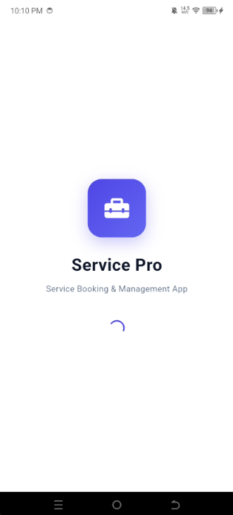
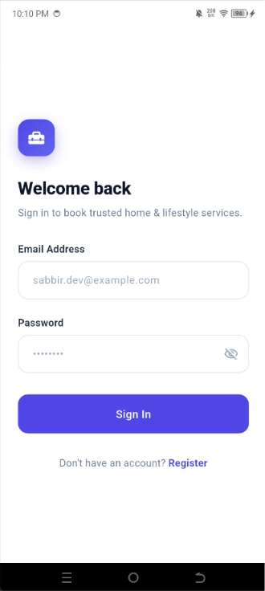
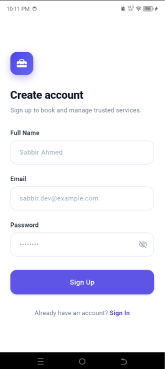
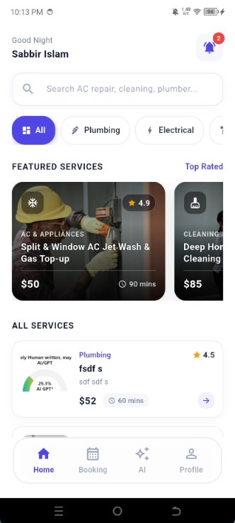
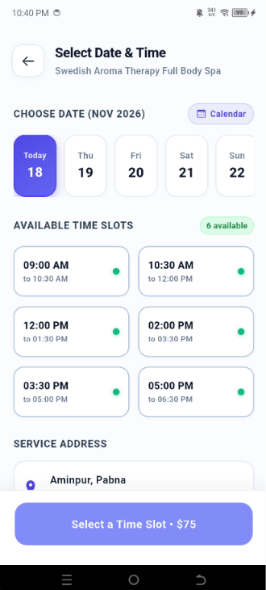
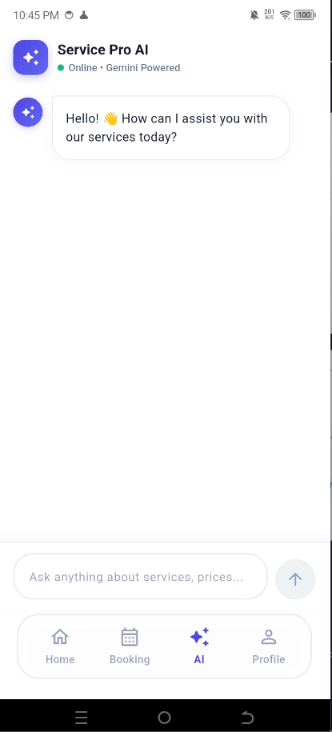
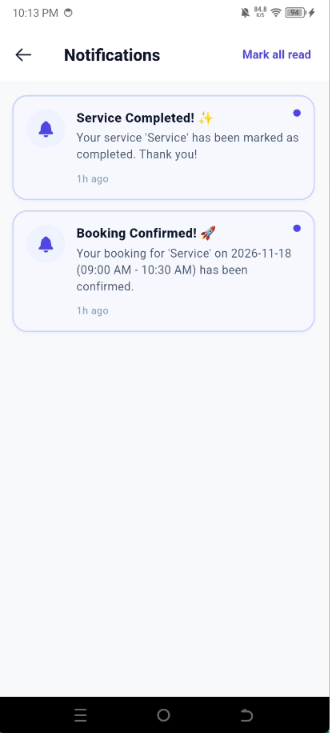
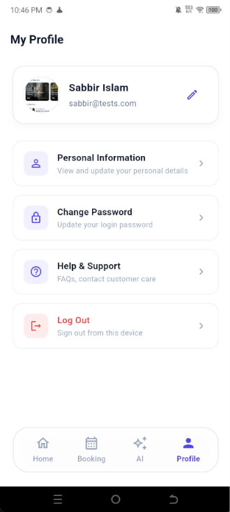
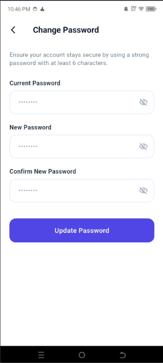

# ServicePro — Service Booking & Management App (Flutter)

A modern, cross-platform mobile application built with **Flutter**, **Dart**, and **Riverpod** that enables customers to explore home & lifestyle services, book time-slot appointments with real-time conflict prevention, manage bookings, receive live status notifications, and interact with a backend-powered **AI Service Assistant**.

---

## 📱 App Screenshots

### 🔐 Authentication & Onboarding
| Splash Screen | Welcome / Sign In | Create Account |
| :---: | :---: | :---: |
|  |  |  |

### 🛠️ Home & Smart Appointment Booking
| Home & Category Filter | Service Details | Slot & Schedule Picker |
| :---: | :---: | :---: |
|  |  |  |

### 🤖 AI Assistant & Notifications
| AI Assistant (Gemini) | Notification Center |
| :---: | :---: |
|  |  |

### 👤 Profile & Security
| User Profile | Change Password |
| :---: | :---: |
|  |  |

---

## 🚀 Key Features

- **Authentication & Persistent Session:**
  - User registration (`Full Name`, `Email`, `Password`), secure login, and session logout.
  - JWT-based session persistence with secure storage and automatic token authorization headers.
- **Home & Service Discovery:**
  - Browse services categorized by core domains (`Plumbing`, `Electrical`, `Painting`, `AC & Appliances`, `Cleaning`, `Spa`).
  - Real-time keyword search, category filtering chips, and a high-resolution **Featured Services** carousel.
- **Service Details & Smart Appointment Booking:**
  - Comprehensive service overview including duration, ratings, pricing, and scope of work.
  - Interactive calendar & real-time time-slot picker that automatically flags occupied slots to eliminate double-booking.
- **My Bookings & Live Status Tracking:**
  - Structured tabs for **Upcoming** (`Pending`, `Confirmed`) and **Previous** (`Completed`, `Cancelled`) bookings.
  - View full appointment breakdown, service address, and cancel pending reservations.
- **Two-Way In-App Notifications:**
  - Real-time notification badge and activity feed alerting users when their booking status changes (`Confirmed`, `Completed`, etc.).
- **AI Service Assistant (Gemini Powered):**
  - Conversational AI assistant powered by **Google Gemini** for intelligent service recommendations, price inquiries, and instant support.
- **User Profile & Account Security:**
  - View and modify profile information (`name`, `email`, `avatar`, `address`).
  - In-app password change and secure multi-device session management.

---

## 🛠️ Tech Stack & Architecture

- **Framework:** [Flutter](https://flutter.dev/) (SDK ^3.12.2) & [Dart](https://dart.dev/)
- **Routing:** [GoRouter](https://pub.dev/packages/go_router)
- **State Management:** [Flutter Riverpod](https://pub.dev/packages/flutter_riverpod)
- **Networking:** [Dio](https://pub.dev/packages/dio) with JWT interceptors & error handlers
- **Local Storage:** [flutter_secure_storage](https://pub.dev/packages/flutter_secure_storage)
- **Responsive UI:** [flutter_screenutil](https://pub.dev/packages/flutter_screenutil)
- **Architecture:** Feature-First / Clean Layered Architecture (`models/`, `services/`, `providers/`, `views/`, `widgets/`)

### 📂 Folder Structure

```text
lib/
├── core/
│   ├── constants/        # API endpoints, app colors, typography & assets
│   └── network/          # Authenticated HTTP client & error interceptors
├── models/               # User, Service, Booking, Notification, AI Chat models
├── providers/            # Riverpod state providers & async notifiers
├── services/             # Auth, Service, Booking, Notification & AI API services
├── views/
│   ├── auth/             # Login & Registration screens
│   ├── home/             # Home screen, search, category filter & featured banner
│   ├── services/         # Service details & appointment booking screens
│   ├── bookings/         # My Bookings (Upcoming/Previous) & booking details
│   ├── notifications/    # In-app notification center
│   ├── ai_assistant/     # AI Service Assistant chat screen
│   └── profile/          # User profile & password management
└── widgets/              # Reusable UI cards, status pills, loaders & empty states
```

---

## 🏁 Getting Started

### Prerequisites

- Flutter SDK: `>=3.12.2`
- Dart SDK: `>=3.0.0`
- Android Studio / VS Code with Flutter extension
- Android or iOS device / emulator

### Installation & Run

1. **Clone the repository:**
   ```bash
   git clone https://github.com/your-username/service_pro.git
   cd service_pro
   ```

2. **Install dependencies:**
   ```bash
   flutter pub get
   ```

3. **Run the application:**
   ```bash
   flutter run
   ```
